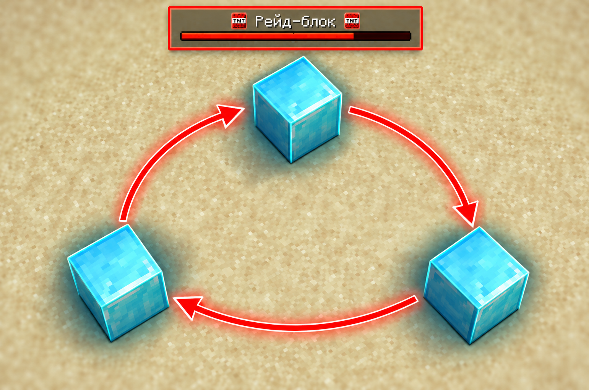

# Рейд-блок

<figure><figcaption></figcaption></figure>

Рейд-блок отображается в меню привата **/ps menu**.

<figure><figcaption></figcaption></figure>

Пока рейд-блок **активен**, **глобальный ремонт** базы **заблокирован** в течение **120** секунд. Каждое новое разрушение крепкого блока **снова** отсчитывает **2 минуты с начала.**

### Когда включается рейд-блок

* Блок защиты полностью взорвали **взрывчаткой** – динамит, взрывные стрелы, трезубцы. Удары руками и инструментами, гниение рейд-блок **не включают**.
* Взрыв **полностью разрушил** блок с максимальной прочностью **500 HP** и больше. Взрыв блока с **маленькой** максимальной прочностью **не** запускает рейд-блок.

<figure><figcaption></figcaption></figure>

### Что блокирует рейд блок

* **Ремонтная кисть** не работает на блоках, которые были повреждены взрывом.
* **Глобальный ремонт** через наковальню в меню – полностью заблокирован.
* **Новые блоки** ставятся с **половиной начальной прочности**. Если прочность при установке медного блока – 500 HP, то при рейдблоке – 250 HP. (максимальная прочность остается прежней)
* **Новые блоки**, поставленные во время рейда, **нельзя** чинить кистью до конца рейд-блока.
* **Эндер-сундук недоступен всем** участникам привата во время рейд-блока вне зависимости от местонахождения.

Рейд-блок включается сразу на **всех пересекающихся приватах.** Если поставить новое ядро рядом с приватом под рейд-блоком, новый приват тоже окажется под рейд-блоком. Нельзя обойти рейд-блок новым ядром.

<figure><figcaption></figcaption></figure>

### Горячий блок VS Рейд-блок

Горячие блоки это **не то же** самое состояние, что и рейд-блок. Если чужой взрыв **повредил** блок или ядро, но **не разрушил,** этот блок на **2 минуты** становится «горячим».

**Чем горячий блок отличается от рейд-блока:**

* Горячим становится **один конкретный блок**, а рейд-блок действует на **весь приват**.
* Горячий блок запрещает только ремонт **этого блока** кистью, а массовый ремонт и эндер-сундук **остаются доступны**.

<figure><figcaption></figcaption></figure>
