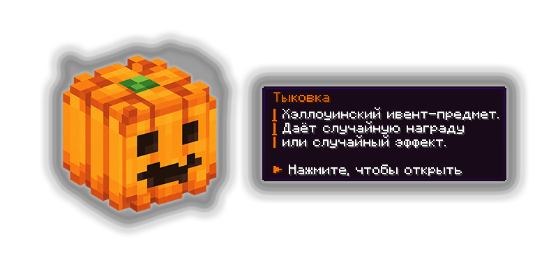

# 🎃 Хэллоуинский ивент

Тыковки — новые сезонные предметы, которые появляются во время хэллоуинского вайпа на Лайт Анархии с 23 октября. При их использовании можно получить интересные вещички.

## Где получить Тыковки?

<figure><figcaption></figcaption></figure>

Тыковки можно найти, участвуя в ивентах: «Груз», «Сокровищница», «Тыпо», «Посылка», «Корабль», «Цветочная поляна», «Золотая лихорадка», «Кубик».


Следите за уведомлениями в чате о старте ивентов . Узнать, какой сейчас проходит ивент, можно командой `/event`


## Что можно получить за активацию Тыковки?

| Дьявольский контракт             | 1 донат-кейс стоимостью 160 коинов                                              | 0,0102% |
| -------------------------------- | ------------------------------------------------------------------------------- | ------- |
| Ошибочный перевод брокера        | 1–100 коинов                                                                    | 0,1018% |
| Титул местной нечисти            | 1 случайный уникальный титул: «Тыквенный», «Призрак», «Бедность», «босс Лайта». | 0,1018% |
| Клинок из могилы                 | 1 меч Infinity / Eternity / Stinger / Цербера                                   | 0,5091% |
| Ключ от чужого счастья           | 1 Универсальный ключ                                                            | 0,5091% |
| Наследство Eternity              | 1 случайный предмет Eternity                                                    | 1,0182% |
| Заначка скупщика                 | Монеты стоимостью 0,1–1 коина                                                   | 2,0365% |
| Порция просроченного зелья       | Тошнота и Замедление II                                                         | 2,0365% |
| Инструменты похитителя спавнеров | 1–2 Стиллера                                                                    | 3,0547% |
| Награда мёртвого казначея        | 10–20 сапфиров за победу над зомби                                              | 3,0547% |
| Добыча последнего рейдера        | 1 Стиллер / 1–3 C4 / 2–4 Динамита Б за победу над скелетом                      | 3,0547% |
| Услуга призрачного кузнеца       | Восстановление 10–25% прочности предметов                                       | 3,0547% |
| Призрачный рейд                  | 1–3 C4 / 1–6 Динамита Б / 1–12 Динамита А                                       | 3,0547% |
| Билет на ведьмин полёт           | Левитация и 1–3 Взрывные штучки                                                 | 3,0547% |
| Двойной подарок                  | 2 разных приза из исходов №4–14                                                 | 3,0547% |
| Взрывной сюрприз                 | 1 зажжённый Динамит А                                                           | 3,0547% |
| Сапфировая россыпь               | 5–25 сапфиров                                                                   | 4,0729% |
| Снег из преисподней              | 6–12 Комов снега Лайта                                                          | 4,0729% |
| Подарок Джека                    | 3–6 Светильников Джейка                                                         | 4,0729% |
| Запас проклятых яиц              | 8–16 осколочных                                                                 | 4,0729% |
| Крысиный стеш                    | 8–16 пороха, 1–2 Динамита Б, 2–4 чарки                                          | 4,0729% |
| Аптечка ведьмы                   | 12–24 зелья Исцеления II / 2–4 Исцеления III                                    | 5,0911% |
| Допинг оборотня                  | 3–9 зелий Силы III / Скорости III                                               | 5,0911% |
| Карманный подвал                 | 3–6 обычных / взрывных трапок                                                   | 5,0911% |
| Запас станов                     | 3–6 станов                                                                      | 5,0911% |
| Набор начинающего рейдера        | 1–2 C4 / 2–4 Динамита Б                                                         | 5,0911% |
| Укус голодной тыквы              | Потеря 2–3 сердец, без награды                                                  | 5,0911% |
| Души прошлого вайпа              | 3 000–10 000 XP                                                                 | 6,1094% |
| Отсрочка смерти                  | 1–2 тотема бессмертия                                                           | 6,1094% |
| Ужин бессмертного                | 8–16 золотых / 1–2 зачарованных золотых яблока                                  | 6,1094% |


Условия получения титулов

* Повторно получить уже имеющийся титул нельзя.
* Если титул уже есть, выбирается другой, ещё не полученный.
* Если игрок собрал все четыре титула, этот исход больше не может ему выпасть.
* Дата получения каждого титула фиксируется как 23.10.2026, независимо от фактической даты активации Тыковки.

