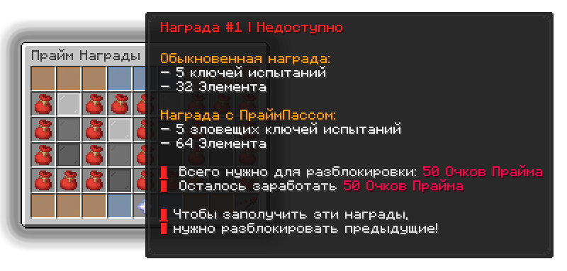
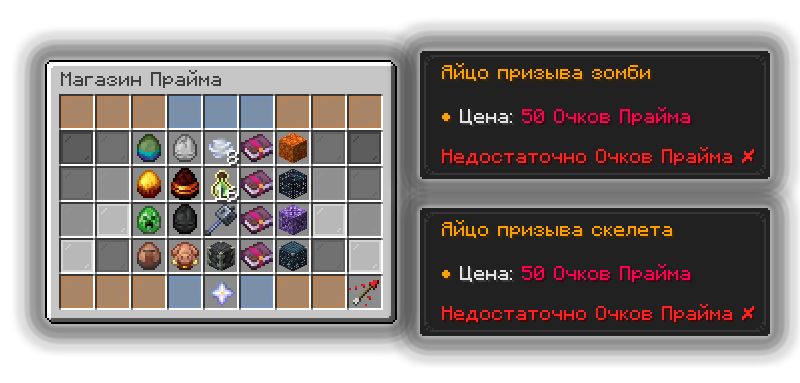

# ПраймПасс

ПраймПасс (боевой пропуск) — идеальная механика, чтобы превратить свои приключения на Прайме в дополнительный источник наград выполняя челленджи.

## Как открыть ПраймПасс

Меню боевого пропуска можно открыть по команде `/pass`

## Челленджи и награды

### Виды челленджей

Челленджи простыми словами — это задания боевого пропуска, за выполнение которых вы будете получать очки Прайма.

<figure><figcaption></figcaption></figure>

<table data-card-wrap="false" data-view="cards"><thead><tr><th align="center"></th><th></th><th data-type="image"></th><th data-hidden data-card-cover data-type="image">Cover image</th></tr></thead><tbody><tr><td align="center"><h4>Обыкновенные челленджи</h4></td><td>Категория, состоящая из самых обычных и простых челленджей.</td><td></td><td data-object-fit="cover"><a href="../.gitbook/assets/inventory (3).png">inventory (3).png</a></td></tr><tr><td align="center"><strong>Челленджи свежайшей версии</strong></td><td>Челленджи, которые связаны с новой версией 1.21.11.</td><td></td><td><a href="../.gitbook/assets/inventory (4).png">inventory (4).png</a></td></tr><tr><td align="center"><h4>Челленджи на время</h4></td><td>Время бросает тебе вызов! Выбирай челлендж и успей его выполнить за отведенное время.</td><td></td><td><a href="../.gitbook/assets/inventory (5).png">inventory (5).png</a></td></tr><tr><td align="center"><h4>Челленджи особенностей Прайма</h4></td><td>Челленджи, которые полностью связаны с механиками самого режима.</td><td></td><td><a href="../.gitbook/assets/inventory (6).png">inventory (6).png</a></td></tr><tr><td align="center"><h4>Сложнейшие челленджи</h4></td><td>Если вы вдруг из тех, кто вместо туалетной бумаги предпочитает наждачную, то эта категория челленджей именно для вас.</td><td></td><td><a href="../.gitbook/assets/inventory (7).png">inventory (7).png</a></td></tr><tr><td align="center"><h4>Потайные челленджи</h4></td><td>Челленджи, которые открываются после открытия всех 120 челленджей предыдущих 5 категорий.</td><td></td><td></td></tr></tbody></table>

### Праймовые награды

<figure><figcaption></figcaption></figure>

Разблокировать награды боевого пропуска можно за Очки Прайма, которые выдаются в качестве награды за выполнение челленджей.

Список обыкновенных наград и с ПраймПассом

| Номер награды | Обыкновенная награда                                                                                           | Награда с ПраймПассом                                                                                                       |
| ------------- | -------------------------------------------------------------------------------------------------------------- | --------------------------------------------------------------------------------------------------------------------------- |
| 1             | 5 ключей испытаний, 32 Элемента.                                                                               | 5 зловещих ключей испытаний, 64 Элемента.                                                                                   |
| 2             | 16 эндер-жемчугов, 32 плода хоруса, 24 особых заряда ветра.                                                    | 2 стакнутых Ультимативных Зелья, 64 цветка хоруса, 64 эндерняка.                                                            |
| 3             | Динамитный Бур I.                                                                                              | 128 Элементов.                                                                                                              |
| 4             | 32 огненных стержня, 32 вихревых стержня.                                                                      | Случайное яйцо призыва (Вихрь, Ифрит).                                                                                      |
| 5             | 64 обсидиана, 32 алмаза.                                                                                       | 64 плачущего обсидиана, 32 светокамня.                                                                                      |
| 6             | 1 тотем бессмертия.                                                                                            | 2 тотема бессмертия.                                                                                                        |
| 7             | 5 случайных особых ключей испытаний.                                                                           | 5 случайных особых зловещих ключей испытаний.                                                                               |
| 8             | Рассадник мобов.                                                                                               | Рассадник испытаний.                                                                                                        |
| 9             | 64 пороха, 64 песка, 64 кремния.                                                                               | 64 песка душ, 64 черепа визер-скелета, 64 ТНТ.                                                                              |
| 10            | 64 пузырька опыта.                                                                                             | 50 уровней опыта.                                                                                                           |
| 11            | 1 маяк, 32 блока железа.                                                                                       | 64 блока железа.                                                                                                            |
| 12            | 125 гемов.                                                                                                     | 250 гемов.                                                                                                                  |
| 13            | Случайное яйцо призыва (Крипер, Визер-скелет).                                                                 | Случайное яйцо призыва (Крестьянин, Зомби-крестьянин).                                                                      |
| 14            | Элитры.                                                                                                        | 64 фейерверка I, 64 фейерверка II, 64 фейерверка III, Книга на прочность III, Книга на починку.                             |
| 15            | Огромный привет, 4 древних обломка.                                                                            | Особый привет.                                                                                                              |
| 16            | 4 незеритовых улучшения.                                                                                       | 4 незеритовых слитка.                                                                                                       |
| 17            | 32 яйца нюхача, 32 черепашьих яйца, 16 обычных куриных яиц, 16 коричневых куриных яиц, 16 голубых куриных яиц. | 1 зловещая бутылочка I, 1 зловещая бутылочка II, 1 зловещая бутылочка III, 1 зловещая бутылочка IV, 1 зловещая бутылочка V. |
| 18            | 24 золотых яблока.                                                                                             | 4 зачарованных золотых яблока.                                                                                              |
| 19            | 5 случайных особых зловещих ключей испытаний.                                                                  | 192 Элемента.                                                                                                               |
| 20            | Рассадник испытаний.                                                                                           | Зловещий рассадник испытаний.                                                                                               |
| 21            | Случайное яйцо призыва (Слизень, Магмовый куб).                                                                | Случайное яйцо призыва (Пиглин, Зомбифицированный пиглин).                                                                  |
| 22            | 10 зелий силы II, 10 зелий скорости II, 10 зелий огнестойкости, 10 зелий регенерации, 10 зелий невидимости.    | 64 золотых блока.                                                                                                           |
| 23            | Случайное яйцо призыва (Гаст, Пиглин, Поборник).                                                               | Случайное яйцо призыва (Ведьма, Зомбифицированный Пиглин, Железный голем).                                                  |
| 24            | Рог Легендарного Барана.                                                                                       | 500 гемов.                                                                                                                  |


Для получения наград с ПраймПассом необходимо приобрести сам ПраймПасс на сайте [holyworld.me](https://holyworld.ru/payment/prime/310)


### Магазин за Очки Прайма

<figure><figcaption></figcaption></figure>

Имея при себе достаточно много Очков Прайма, вы можете прикупить себе интересные вещички в Магазине Прайма.

Список товаров в магазине Прайма

| Товар                           | Цена в Очках Прайма |
| ------------------------------- | ------------------- |
| Яйцо призыва зомби              | 50                  |
| Яйцо призыва скелета            | 50                  |
| Особый заряд ветра ×8           | 10                  |
| Сомнительный разящий клинок I   | 20                  |
| Огромный приват                 | 25                  |
| Яйцо призыва ифрита             | 100                 |
| Яйцо призыва магмового куба     | 100                 |
| Пузырёк опыта ×16               | 20                  |
| Сомнительная удача I            | 30                  |
| Рассадник мобов                 | 75                  |
| Яйцо призыва крипера            | 200                 |
| Яйцо призыва скелета-иссушителя | 200                 |
| Прочнейшая Булава               | 50                  |
| Сомнительная эффективность I    | 40                  |
| Особый приват                   | 150                 |
| Яйцо призыва жителя             | 500                 |
| Яйцо призыва пиглина            | 500                 |
| Укреплённый глубинный сланец    | 50                  |
| Сомнительная добыча I           | 50                  |
| Рассадник испытаний             | 100                 |

