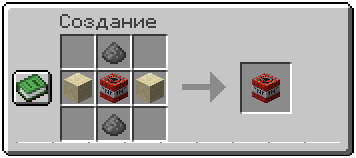

# Кастомные предметы

Кастомные предметы — это особые предметы с уникальными свойствами, они помогают, облегчают игру и дают полезные эффекты.

## Ключи к событиям

| Предмет                 | Описание                                                                                                                                                                                                                                   | Как получить                                                                                                                                                                       |
| ----------------------- | ------------------------------------------------------------------------------------------------------------------------------------------------------------------------------------------------------------------------------------------ | ---------------------------------------------------------------------------------------------------------------------------------------------------------------------------------- |
| Рог легендарного барана | При использовании запускает небольшое событие, которое спавнит особого моба, создающего локацию с шалкерами лута. В зависимости от мира событие может отличаться. Для активации необходимо свободное место. Нельзя активировать в привате. | Купить в магазине ценностей `/shop` за 699 гемов, найти в сундуках ванильных данжей.                                                                                               |
| Зловещая бутылочка      | При использовании дает эффект Дурного знамения, что позволяет вызвать рейд на деревню или вызвать особую битву у Рассадника испытаний.                                                                                                     | Купить в магазине ценностей `/shop` за 99 гемов, найти в вазах в «Камерах испытаний», с шансом получить за убийство «Зловещего Вардена», выдается за достижение 12 этапа у Скупца. |

## Динамиты

| Предмет            | Описание                                                                                                                                                                                                                                                                                                                                                                                                        | Как получить                                                                                                                                                                                                                                                                                                                                        |
| ------------------ | --------------------------------------------------------------------------------------------------------------------------------------------------------------------------------------------------------------------------------------------------------------------------------------------------------------------------------------------------------------------------------------------------------------- | --------------------------------------------------------------------------------------------------------------------------------------------------------------------------------------------------------------------------------------------------------------------------------------------------------------------------------------------------- |
| Удлиненный динамит | Это модифицированная версия обычного динамита. Главное отличие — увеличенное время до детонации: он взрывается через 8 секунд после поджига, тогда как обычный — через 4 секунды.                                                                                                                                                                                                                               | 
Для создания требуется:

1 × обычный динамит 2 × порох 2 × песок

                                                                                                                                                                               |
| Динамитный бур     | 
Динамитный бур позволяет выкапывать большие территории — установите его где-нибудь в мире, и он начнет выкапывать территорию в соответствии с его уровнем до бедрока.
<ul><li>Динамитные Буры существуют в 5 размерах (уровнях): 21х21, 37x37, 55х55, 77х77 и 101х101 блоков.</li><li>Когда бур закончит свою работу или он будет вхолостую стоять на месте, то он пропадёт в течение 15 минут.</li></ul> | 
Купить в магазине ценностей <code>/shop</code> за 399 гемов, можно найти в Особых Хранилищах и на ивентах, также можно добыть при использовании Рога Легендарного Барана.  Чтобы повысить уровень Динамитного бура на один, поместите его в верстак и окружите 8 стаками Элементов (512 штук). Так бур I уровня можно последовательно улучшить до V уровня.

 |

## Необычные предметы

| Предмет                        | Описание                                                                                                                                                                                                                                                                                                                                                                                                                                              | Как получить                                                                                                                                                                                              |
| ------------------------------ | ----------------------------------------------------------------------------------------------------------------------------------------------------------------------------------------------------------------------------------------------------------------------------------------------------------------------------------------------------------------------------------------------------------------------------------------------------- | --------------------------------------------------------------------------------------------------------------------------------------------------------------------------------------------------------- |
| Прочнейшая Булава              | 
Это необычайный предмет, являющийся усиленной версией обычной булавы.  - Обычная булава имеет 12 единиц прочности, а Прочнейшая — 48 единиц. При этом все остальные ограничения обычной булавы для неё сохраняются. - На булаву разрешены все зачарования, кроме Починки. - Прочнейшую Булаву нельзя ремонтировать:

через /fix; в наковальне с использованием Стержня вихря.
                                                 | Купить в магазине ценностей `/shop` за 499 гемов, найти в особой вазе в Камерах испытаний, выдается за достижение 27 этапа у Скупца.                                                                      |
| Ультимативное зелье            | При использовании зелья вы получите эффекты: сила 2 уровня на 2 минуты, скорость 2 уровня на 2 минуты, регенерация на 2 минуты и огнестойкость на 10 минут. Ультимативное зелье можно сделать взрывным.                                                                                                                                                                                                                                                                                           | Купить в магазине ценностей `/shop` за 69 гемов, найти в особой вазе в Камерах испытаний, выдается за первое место на ивентах, выдается за достижение 3 этапа у Скупца                                    |
| Особый заряд ветра             | Это усиленная версия обычного Заряда Ветра, которая не требует перезарядки после использования.                                                                                                                                                                                                                                                                                                                                                       | Купить 16 шт. в магазине ценностей `/shop` за 49 гемов, найти в особой вазе в Камерах испытаний, выдается за достижение 6 этапа у Скупца, можно получить на ивентах с боссами                             |
| Незеритовое улучшение          | Это предмет, который используется для создания незеритовых предметов на столе кузнеца.                                                                                                                                                                                                                                                                                                                                                                | Купить в магазине ценностей `/shop` за 69 гемов, выдается за достижение 14 этапа у Скупца, можно получить в качестве награды после ивента «Древний город».                                                |
| Укрепленный глубинный сланец   | 
Это особый блок, который по задумке работает почти как бедрок, но его можно сломать киркой. При этом его нельзя разрушить динамитом или даже визером, а сам блок является недобываемым.
<ul><li>Его нельзя устанавливать: на Y -60 и ниже в обычном мире; на Y 123–127 в обычном мире; на Y 4 и ниже в аду.</li><li>Можно устанавливать только внутри регионов: в маленьком только 2, в среднем 3, в большом 4, огромном 5, особом 6.</li></ul> | Купить в магазине ценностей /shop за 499 гемов, найти в особых вазах в Камерах испытаний, получить за первое место на ивенте, выдается за достижение 4 этапа у Скупца.                                    |
| Особый ключ Испытаний          | Необычный Ключ, с помощью которого на /warp key можно обзавестись целыми горами редких и необычных вещичек                                                                                                                                                                                                                                                                                                                                            | Купить в магазине ценностей `/shop` за 99 гемов, обменять ванильный «Ключ Испытаний» и 2 элемента у Ключника `/warp key`, у Ключника на `/warp key` также можно купить случайный особый ключ за Элементы. |
| Особый Зловещий ключ испытаний | Необычайнейший ключ, применив который на /warp key можно заполучить ценнейшие и могущественнейшие предметы!                                                                                                                                                                                                                                                                                                                                           | Купить в магазине ценностей `/shop` за 249 гемов, обменять ванильный «Зловещий ключ испытаний» и 5 элементов у Ключника `/warp key`                                                                       |

## Список лута с кейсов

Особое хранилище

| Категория           | Предметы                                                                                                                                                                                                                                                                                                                                                                                                                                                                                                                                                                                                                                                                                                                                                                                           |
| ------------------- | -------------------------------------------------------------------------------------------------------------------------------------------------------------------------------------------------------------------------------------------------------------------------------------------------------------------------------------------------------------------------------------------------------------------------------------------------------------------------------------------------------------------------------------------------------------------------------------------------------------------------------------------------------------------------------------------------------------------------------------------------------------------------------------------------- |
| **Оружейный**       | Алмазный меч (Острота III–V, Прочность I–III, Заговор огня I–II, Добыча I–III, Отдача I–II, Починка), алмазный топор (Острота II–V, Прочность I–III, Эффективность III–V, Починка), лук (Сила III–V, Прочность I–III, Воспламенение, Бесконечность, Откидывание I–II, Починка), арбалет (Быстрая перезарядка I–III, Прочность II–III, Пронзающая стрела II–IV, Тройной выстрел, Починка), чародейские книги (Острота II–V, Заговор огня I–II, Добыча II–III, Быстрая перезарядка I), кристалл Энда, якорь возрождения, заряд ветра, стрела, спектральная стрела.                                                                                                                                                                                                                                   |
| **Броневой**        | Алмазный шлем (Защита III–IV, Прочность I–III, Подводное дыхание II–III, Подводник, Взрывоустойчивость III–IV, Починка), алмазный нагрудник (Защита III–IV, Прочность I–III, Шипы I–II, Взрывоустойчивость III–IV, Починка), алмазные поножи (Защита III–IV, Прочность I–III, Шипы I–II, Взрывоустойчивость III–IV, Починка), алмазные ботинки (Защита III–IV, Прочность I–III, Невесомость III–IV, Подводная ходьба II–III, Взрывоустойчивость III–IV, Починка), черепаший панцирь (Защита III–IV, Подводное дыхание II–III, Подводник, Прочность III, Починка), щит (Прочность II–III, Починка), чародейские книги (Защита III–IV, Прочность II–III, Подводное дыхание II–III, Подводная ходьба II–III, Подводник, Взрывоустойчивость III–IV, Невесомость III–IV, Починка).                      |
| **Яичный**          | Яйцо призыва курицы, свиньи, овцы, лошади, пчелы, осла, мула, панды, белого медведя, попугая, ламы, снежного голема, утопленника, иглобрюха, лосося, трески, всполоха, лавомерки, слизня, кролика, стража, коровы, верблюда, визер-скелета, магмового куба, тихони, аксолотля, болотника, кадавра, зимогора, пустынника, крипера.                                                                                                                                                                                                                                                                                                                                                                                                                                                                  |
| **Особые предметы** | Крупица (Пластинка — 5), заряд ветра (без перезарядки), сомнительная книга (Разящий клинок I), сомнительная книга (Разящий клинок II), сомнительная книга (Удача I), сомнительная книга (Удача II), ультимативное зелье (Сила II, Скорость II, Регенерация, Огнестойкость), ключ испытаний, зловещий ключ испытаний, заговорённое золотое яблоко, рассадник монстров (спавнер свиней), смоляной блок, элемент, динамитный бур I.                                                                                                                                                                                                                                                                                                                                                                   |
| **Ресурсный**       | Алмаз, изумруд, рудное золото, рудное железо, кусочек золота, железный слиток, золотой слиток, редстоуновая пыль, лазурит, незерский кварц, обсидиан, плачущий обсидиан, железный блок, золотой блок, алмазный блок, изумрудный блок, порох, огненный порошок, огненный стержень, сгусток слизи, сгусток магмы, эндер-жемчуг, мембрана фантома, маринованный паучий глаз, бутылочка мёда, слеза гаста, панцирь шалкера, заряд ветра, вихревой стержень, пузырёк опыта, динамит, золотое яблоко, заговорённое золотое яблоко, древние обломки, незеритовый лом, незеритовый слиток, незеритовое улучшение (кузнечный шаблон), ключ испытаний, зловещий ключ испытаний, тотем бессмертия, навершие булавы, незеритовая конская броня (+19 броня, +3 твёрдость брони, +1 сопротивление отбрасыванию). |

Особое зловещие хранилище

| Категория           | Предметы                                                                                                                                                                                                                                                                                                                                                                                                                                                                                                                                                                                                                                                                                                                                                                                           |
| ------------------- | -------------------------------------------------------------------------------------------------------------------------------------------------------------------------------------------------------------------------------------------------------------------------------------------------------------------------------------------------------------------------------------------------------------------------------------------------------------------------------------------------------------------------------------------------------------------------------------------------------------------------------------------------------------------------------------------------------------------------------------------------------------------------------------------------- |
| **Оружейный**       | Алмазный меч (Острота III–V, Прочность I–III, Заговор огня I–II, Добыча I–III, Отдача I–II, Починка), алмазный топор (Острота II–V, Прочность I–III, Эффективность III–V, Починка), лук (Сила III–V, Прочность I–III, Воспламенение, Бесконечность, Откидывание I–II, Починка), арбалет (Быстрая перезарядка I–III, Прочность II–III, Пронзающая стрела II–IV, Тройной выстрел, Починка), чародейские книги (Острота II–V, Заговор огня I–II, Добыча II–III, Быстрая перезарядка I), кристалл Энда, якорь возрождения, заряд ветра, стрела, спектральная стрела.                                                                                                                                                                                                                                   |
| **Броневой**        | Алмазный шлем (Защита III–IV, Прочность I–III, Подводное дыхание II–III, Подводник, Взрывоустойчивость III–IV, Починка), алмазный нагрудник (Защита III–IV, Прочность I–III, Шипы I–II, Взрывоустойчивость III–IV, Починка), алмазные поножи (Защита III–IV, Прочность I–III, Шипы I–II, Взрывоустойчивость III–IV, Починка), алмазные ботинки (Защита III–IV, Прочность I–III, Невесомость III–IV, Подводная ходьба II–III, Взрывоустойчивость III–IV, Починка), черепаший панцирь (Защита III–IV, Подводное дыхание II–III, Подводник, Прочность III, Починка), щит (Прочность II–III, Починка), чародейские книги (Защита III–IV, Прочность II–III, Подводное дыхание II–III, Подводная ходьба II–III, Подводник, Взрывоустойчивость III–IV, Невесомость III–IV, Починка).                      |
| **Яичный**          | Яйцо призыва фантома, магмового куба, черепахи, стража, визер-скелета, всполоха, крипера, разбойника, кролика, шалкера, эндермена, грибной коровы, наутилуса, тихони, спрута, светящегося спрута, тропической рыбы, жителя, поборника, пиглина, нюхача, гаста, вызывателя. Рассадник испытаний (спавнер любых существ в радиусе 5 блоков).                                                                                                                                                                                                                                                                                                                                                                                                                                                         |
| **Особые предметы** | Крупица (Пластинка — 5), ультимативное зелье (Сила II, Скорость II, Регенерация, Огнестойкость), особый заряд ветра (без перезарядки), сомнительная книга (Эффективность I), сомнительная книга (Эффективность II), сомнительная книга (Эффективность III), сомнительная книга (Добыча I), сомнительная книга (Добыча II), сомнительная книга (Добыча III), сомнительная книга (Удача III), сомнительная книга (Разящий клинок III), зловещая бутылочка (Дурной знак), зачарованное золотое яблоко, элемент, прочнейшая булава, зловещий ключ испытаний, укреплённый глубинный сланец, особый приват (35×35×35), рог легендарного барана, рассадник испытаний (спавнер любых существ в радиусе 5 блоков), динамитный бур I (21×21, добыча ресурсов 10%).                                           |
| **Ресурсный**       | Алмаз, изумруд, рудное золото, рудное железо, кусочек золота, железный слиток, золотой слиток, редстоуновая пыль, лазурит, незерский кварц, обсидиан, плачущий обсидиан, железный блок, золотой блок, алмазный блок, изумрудный блок, порох, огненный порошок, огненный стержень, сгусток слизи, сгусток магмы, эндер-жемчуг, мембрана фантома, маринованный паучий глаз, бутылочка мёда, слеза гаста, панцирь шалкера, заряд ветра, вихревой стержень, пузырёк опыта, динамит, золотое яблоко, заговорённое золотое яблоко, древние обломки, незеритовый лом, незеритовый слиток, незеритовое улучшение (кузнечный шаблон), ключ испытаний, зловещий ключ испытаний, тотем бессмертия, навершие булавы, незеритовая конская броня (+19 броня, +3 твёрдость брони, +1 сопротивление отбрасыванию). |

