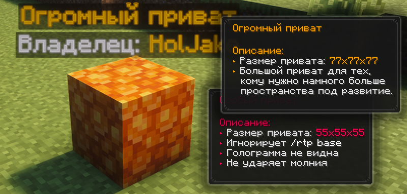

# Приваты

Приваты (регионы) — это способ защиты территории от посторонних игроков с помощью специальных блоков. Каждый такой блок создаёт защищённую зону, в которой только владелец и добавленные им игроки могут строить и ломать блоки.

<figure><figcaption></figcaption></figure>

## Как заприватить территорию

Чтобы заприватить территорию, достаточно взять подходящий **блок привата** и установить его на свободной территории. Главное — убедиться, что в выбранном месте нет другого региона, который пересекается с будущим приватом. Если территория свободна, после установки блока она будет защищена.


После успешной установки привата в блок ударит молния, а над ним появится голограмма с информацией о владельце и типе привата.


## Типы приватов

| Блок привата     | Размер   | Описание                                                                                                                                              | Как получить                                     |
| ---------------- | -------- | ----------------------------------------------------------------------------------------------------------------------------------------------------- | ------------------------------------------------ |
| Золотой блок     | 15×15×15 | —                                                                                                                                                     | Скрафтить на верстаке из 9 золотых слитков       |
| Медный блок      | 25×25×25 | —                                                                                                                                                     | Скрафтить на верстаке из 9 медных слитков        |
| Древние обломки  | 35×35×35 | —                                                                                                                                                     | Найти, копаясь в аду.                            |
| Смоляной блок    | 45×45×45 | —                                                                                                                                                     | Купить в магазине ценностей `/shop` за 199 гемов |
| Цветущий аметист | 35×35×35 | Базу с этим приватом нельзя найти через /rtp base, голограмму с информацией о привате не видно через блоки, а молния — индикатор привата — не ударяет | Купить в магазине ценностей `/shop` за 599 гемов |

## Особенности приватов



### Молния как индикатор привата

Для всех обычных регионов действует особое правило: если приват находится внутри блоков или под землёй и его невозможно увидеть, молния будет ударять в поверхность прямо над местом расположения блока привата.

Такой удар молнии становится своеобразным признаком того, что где-то поблизости находится чья-то база. Поэтому скрытый регион может оставаться незаметным визуально, однако система молний фактически позволяет обнаружить его местоположение.



### Установка блока привата

Если установить блок привата с зажатым **Shift**, он будет установлен как обычный блок без создания региона.



### Приваты в РТП

В системе `/rtp` предусмотрен отдельный тип телепортации — телепортация к региону с помощью команды `/rtp base`.



### Регионы внутри Камер испытаний

Все установленные приваты внутри Камер испытаний по истечении 12 часов исчезают вместе с регионом.



### Уведомляющие регионы

Любой регион можно запросто сделать уведомляющим. Всё, что для этого необходимо — с Элементом в руке нажать ПКМ по региону. Далее, настроив уведомления с помощью [@primehw\_bot](https://t.me/primehw_bot), при гриферстве и других подозрительных событиях вы будете получать сообщения от бота, что с приватом что-то происходит. При поломке региона он вновь станет обычным.



### Приваты и ПВП режим

Установить любой приват в ПВП-режиме невозможно, дождитесь окончания режима ПВП, и вы сможете установить приват.



## Команды приватов

| Команда              | Описание                                        |
| -------------------- | ----------------------------------------------- |
| /ps                  | Помощь по приватам                              |
| /ps info             | Информация о привате                            |
| /ps add <никнейм>    | Добавить игрока в приват                        |
| /ps remove <никнейм> | Убрать игрока из привата                        |
| /ps list <игрок>     | Посмотреть, сколькими регионами владеете вы     |
| /ps unhide           | Восстановить блок привата, если он был разрушен |

## Прочие особенности



### Запрет песка душ

Ввиду добавления буров, которые позволят существенно проще выкапывать территории, а также добавления уведомляющих приватов, теперь установить песок душ прямо на уровне бедрока станет невозможно.


